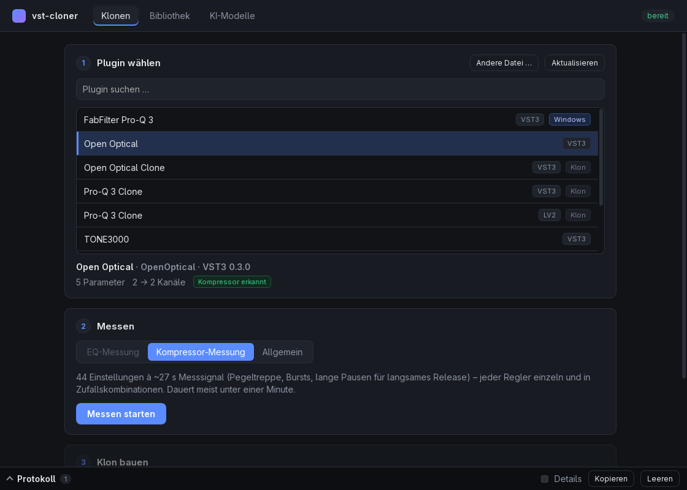

# vst-cloner



Gekaufte Effekt-Plugins unter Linux nutzen: Plugins werden als Black Box vermessen,
als offenes Profil (`.vcprofile`) gespeichert und daraus als freier Klon (LV2/VST3/CLAP)
neu gebaut. Kein dekompilierter Code, keine extrahierten Samples – nur gemessenes Klangverhalten.

Gesamtplan und Meilensteine: [PLAN.md](PLAN.md) · Profilformat: [docs/profile-format.md](docs/profile-format.md)

**Stand: Meilenstein 5 in Arbeit** – Desktop-App, Capture-Host, Profilformat und LLM-Anbindung funktionieren.
Klone (VST3/LV2) gibt es für **parametrische EQs** und **Kompressoren/Limiter**, jeweils mit nachgebauter
Oberfläche des Originals. Distortion/Amp (NAM) folgt.
Getestet unter Linux mit nativen VST3-Plugins und Windows-Plugins über yabridge.

| Klon | Original | Abweichung | Oberfläche |
|---|---|---|---|
| Pro-Q 3 Clone | FabFilter Pro-Q 3 (yabridge) | 0,10 dB über 149 Einstellungen | 74 % Struktur, 98 % Farbe |
| Open Optical Clone | Open Optical (Opto-Kompressor) | 0,50 dB Pegelverlauf über 44 Einstellungen, Oberwellen meist ±2 dB | 82 % Struktur, 95 % Farbe |

## Voraussetzungen

- Node.js ≥ 22.18 (TypeScript läuft direkt, kein Build-Schritt)
- CMake ≥ 3.22 und ein C++20-Compiler (GCC/Clang unter Linux, MSVC unter Windows)

## Einrichten

```bash
npm install
npm run host:configure      # lädt JUCE 9.0.5 herunter
npm run host:build
```

Mit vorhandenem JUCE-Checkout: `cmake -S host -B host/build -DVCH_JUCE_DIR=/pfad/zu/JUCE`.

## Desktop-App

```bash
npm run app        # startet die Oberfläche (beim ersten Mal wird der Rust-Teil kompiliert)
```

Drei Bereiche: **Klonen** (Plugin wählen → Messen → Klon bauen), **Bibliothek** (gespeicherte Profile:
Klon neu bauen ohne Original, exportieren, importieren) und **KI-Modelle** (Anbieter, Schlüssel, Rollen,
Test). Unten zeigt das **Protokoll** jeden Schritt, nach Phasen gegliedert; „Details“ blendet auch die
Ausgaben von Compiler und Host ein.

Im Bereich Klonen wählt die App den Messmodus passend zum Plugin: **EQ-Messung**, **Kompressor-Messung**
oder **Allgemein**. Beim Klonen kann sie außerdem die **Oberfläche des Originals nachbauen** (das Original
wird dafür einmal unsichtbar geöffnet, siehe unten).

Profile und Klone liegen unter `~/.local/share/vst-cloner/` (Windows: `%APPDATA%\vst-cloner`).
Voraussetzung zusätzlich zu oben: Rust (`cargo`) und unter Linux WebKitGTK 4.1.
Die App nutzt vorerst Node.js und den Projektordner – eigenständige Installationspakete folgen mit Meilenstein 8.

## Benutzung (Kommandozeile)

```bash
# Was steckt im Plugin?
npm run vch -- info ~/.vst3/MeinPlugin.vst3

# Was würde gemessen?
npm run vch -- plan ~/.vst3/MeinPlugin.vst3

# Messen und Profil speichern
npm run vch -- capture ~/.vst3/MeinPlugin.vst3 -o mein-plugin.vcprofile

# Profil prüfen / entpacken
npm run vch -- inspect mein-plugin.vcprofile
npm run vch -- extract mein-plugin.vcprofile ./entpackt
```

Oder direkt: `node capture/bin/vch.ts …`

### EQ klonen

```bash
# 1. EQ vermessen (eigener Messplan: jede Filterform bei mehreren Frequenzen, Gains und Güten)
npm run vch -- capture ~/.vst3/MeinEQ.vst3 --class eq --tail 0.25 -o mein-eq.vcprofile

# 2. Klon bauen, mit dem Original vergleichen und optional installieren
npm run vch -- clone mein-eq.vcprofile -o ./mein-eq-clone --install
```

Der Klon ist ein eigenständiges VST3- und LV2-Plugin mit denselben Parameternamen und Regelwegen
wie das Original (gleiche normierte Werte → gleiche Einstellung). Ablauf:

1. **Analyse:** Frequenzgang jeder Messung aus der Impulsantwort.
2. **Fit:** Pro Filterform werden Filterdesign (bilinear oder „matched“ ohne Stauchung nahe Nyquist),
   Frequenz-/Güte-Definition und Q-Kennlinie bestimmt. Ein Teil der Messungen dient nur zur Gegenprobe.
3. **Build:** Eine feste C++-EQ-Engine (`plugin-template/eq`) erhält das Modell als Datendatei.
   Erster Build ca. 1 Minute, danach Sekunden.
4. **Prüfung:** Der fertige Klon wird mit allen Einstellungen gemessen und mit dem Original verglichen.

Modell und Bericht werden im Profil gespeichert (`model/eq.json`, `report.json`); ein erneutes
`vch clone` baut den Klon dann ohne neue Analyse. Einzelschritte: `vch analyze`, `vch verify`.

Unterstützte Formen: Bell, Low/High Shelf, Low/High Cut (6–96 dB/Okt. und „Brickwall“ als gefittetes
elliptisches Filter), Notch, Band Pass, Tilt Shelf, Flat Tilt. Parameteränderungen werden geglättet
(kein Knacken beim Drehen). Nicht unterstützte Formen leitet der Klon durch; der Bericht weist sie aus.

Im Klon-Editor legt ein Klick in die Kurve ein Band an; ziehen ändert Frequenz/Gain, das Mausrad die Güte,
Rechtsklick entfernt das Band. Für das gewählte Band erscheint eine Leiste mit Form, Frequenz, Gain, Güte
und Flanke.

### Kompressor klonen

```bash
# 1. Kompressor vermessen (Pegeltreppe, Bursts, lange Pausen; jeder Regler einzeln + Zufallskombinationen)
npm run vch -- capture ~/.vst3/MeinKompressor.vst3 --class dynamics -o mein-comp.vcprofile

# 2. Klon bauen (vch clone erkennt Kompressor-Profile selbst), mit Oberfläche
npm run vch -- clone mein-comp.vcprofile -o ./mein-comp-clone --gui --install
```

Das Modell bildet einen Kompressor im Steuertakt (32 Samples, kausal) nach: Detektor (RMS oder Spitze,
Feed-forward oder Feedback, mit Energie-Mittelung), Kennlinie mit weichem Knick, Attack, schnelles
Release und einen programmabhängigen langsamen Speicher (Opto-Verhalten). Dazu kommt die Klangfarbe:
eine tanh-Sättigung und die Welligkeit des Detektors, die komprimierte Signale mit Oberwellen färbt.
Der Fit wählt die Variante selbst; jeder Regler wird über eine Tabelle auf die Modellwerte abgebildet.
Zufallskombinationen, die nie zum Fitten benutzt werden, dienen als Gegenprobe. Das Plugin
(`plugin-template/dynamics`) rechnet sample-genau wie das TypeScript-Modell.

### Oberfläche nachbauen

Mit `--gui` (bzw. der Option in der App) öffnet `vch-gui` den Editor des Originals unsichtbar (unter
Linux in Xvfb), bewegt jeden Regler einzeln und leitet aus den Bildern ein Layout ab: Drehregler,
Schieber, Schalter, Auswahlfelder, Wertanzeigen, EQ-Kurve, Flächen, Linien und Texte (mit tesseract
gelesen, falls installiert). Bei Kompressoren läuft zusätzlich ein Testton durch das Original, um die
Pegelreduktions-Nadel zu finden und zu kalibrieren. Gespeichert wird nur das Layout (`model/gui.json`),
keine Grafik des Originals. Der Vergleich Klon ↔ Original landet als Bild im Cache.

Zusätzlich nötig: `xorg-server-xvfb`, optional `tesseract` mit `tesseract-data-eng`/`-deu`.
Hinweise, die ein Plugin beim Öffnen in seinen Editor zeichnet (z. B. FabFilter-Testversion), schließt
`vch-gui` über einen Klick auf „Evaluate“.

### Plugins mit vielen Parametern

Multiband-Plugins haben oft hunderte Parameter, deren Bänder erst aktiviert werden müssen.
Mit `--set` werden Werte für alle Renders fest gesetzt, mit `--include` die zu messenden
Parameter ausgewählt:

```bash
npm run vch -- capture ~/.vst3/yabridge/"Mein EQ.vst3" -o eq-band1.vcprofile \
  --set "Band 1 Used=Used" --set "Band 1 Enabled=Enabled" \
  --include "^Band 1 (Frequency|Gain|Q|Shape)$" --points 7 --random 8
```

Werte für `--set` sind normalisierte Zahlen (0…1) oder Anzeigetexte diskreter Parameter.
Ab Meilenstein 3 erzeugt die App solche Messpläne automatisch je nach Effekt-Klasse.

### Windows-Plugins

- **Unter Linux über yabridge:** Den yabridge-Ordner (z. B. `~/.vst3/yabridge/…`) angeben.
- **Unter Windows:** vch-host mit CMake/MSVC bauen und dort capturen, das Profil
  anschließend unter Linux weiterverarbeiten.

## KI-Modelle einrichten

Der spätere Klon-Agent kann lokale und Cloud-Modelle nutzen. Metadaten (Kontextlänge,
Tool-Unterstützung, Preise) kommen aus dem Anbieter selbst und dem täglich aktualisierten
[models.dev](https://models.dev)-Katalog.

```bash
npm run vch -- llm status                 # Überblick: Anbieter, Schlüssel, Rollen, lokale Server
npm run vch -- llm discover --add         # laufende lokale Server (Ollama, LM Studio, …) übernehmen
npm run vch -- llm add anthropic          # Cloud-Anbieter hinzufügen
npm run vch -- llm key anthropic          # API-Schlüssel im System-Schlüsselbund speichern
npm run vch -- llm models ollama          # Modelle mit Kontext, Tools, Preisen
npm run vch -- llm test ollama/qwen3:8b   # Live-Test: Text, Tool-Aufrufe, strukturierte Ausgabe
npm run vch -- llm role builder anthropic/claude-sonnet-5
```

- **Anbieter:** OpenAI, Anthropic, Google Gemini, Mistral, OpenRouter, Ollama, LM Studio,
  llama.cpp, vLLM sowie jeder OpenAI-kompatible Endpunkt (`vch llm add custom --base-url …
  --catalog <models.dev-id>`, z. B. Groq oder DeepSeek).
- **Rollen:** `analyst` (wertet Plugin-Metadaten mit REA aus, „Dirty Room“) und `builder`
  (schreibt den Klon-Code nur aus Spezifikation und Messdaten, „Clean Room“).
- **Schlüssel** liegen im System-Schlüsselbund (GNOME Keyring/KWallet, Windows-Anmeldeinformationsverwaltung),
  nie in Konfigurationsdateien. Umgebungsvariablen wie `ANTHROPIC_API_KEY` haben Vorrang.
  `vch llm key` fragt den Schlüssel verdeckt ab – am besten in einem normalen Terminal ausführen.
- **Ollama:** Für lange Agent-Sitzungen `OLLAMA_CONTEXT_LENGTH=32768` setzen.

## Aufbau

```
host/      vch-host: C++20/JUCE 9, headless. Lädt VST3/LV2, rendert offline.
           Ausgabe als JSON-Zeilen auf stdout (Plugin-Ausgaben werden nach stderr umgeleitet).
profile/   JSON-Schemas, Reader/Writer mit Prüfsummen, WAV-I/O
capture/   Testsignale, Messplan, Ansteuerung von vch-host, CLI `vch`
agent/     LLM-Anbieter (Vercel AI SDK), models.dev-Katalog, Schlüsselbund, Fähigkeitstests, Rollen
clone/     Analyse, Messpläne, Fits und Codegeneratoren: eq/ (Filter-Fit), dynamics/ (Kompressor-Modell),
           gui/ (Oberflächen-Analyse, Texterkennung), dsp/ (Biquads, elliptische Filter, Optimierer);
           Plugin-Build und Vergleich mit dem Original
plugin-template/
           eq/        C++/JUCE-EQ-Engine (Formeln identisch mit clone/src/dsp/biquad.ts)
           dynamics/  C++/JUCE-Kompressor-Engine (identisch mit clone/src/dynamics/model.ts)
           common/    Parameter und nachgebauter Editor, gemeinsam für alle Vorlagen
host/      zusätzlich vch-gui: öffnet Plugin-Editoren unsichtbar und nimmt sie auf
bridge/    JSON-Zeilen-Schnittstelle zwischen Oberfläche und den Paketen (Jobs, Fortschritt, Protokoll)
apps/desktop/
           Tauri-App: Web-Oberfläche (TypeScript) + Rust-Hülle, die die Bridge startet
```

## Tests

```bash
npm run typecheck
npm test
VCH_TEST_PLUGIN=~/.vst3/MeinPlugin.vst3 npm test   # inkl. Capture mit echtem Plugin
VCH_TEST_MODEL=ollama/qwen3:8b npm test             # inkl. Live-Test eines Modells
VCH_TEST_BUILD=1 npm test                           # inkl. Plugin-Build und Engine-Vergleich
```

## Lizenz

GPL-3.0-or-later (vch-host nutzt JUCE unter GPLv3).
