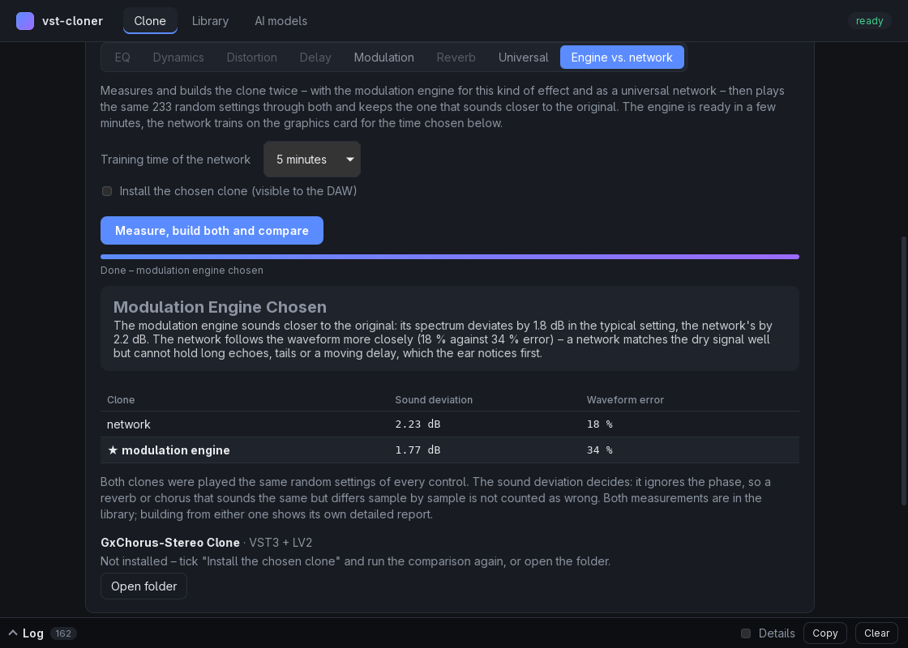

# vst-cloner



Use the effect plugins you bought on Linux: plugins are measured as a black box,
saved as an open profile (`.vcprofile`) and rebuilt from it as a free clone (LV2/VST3/CLAP).
No decompiled code, no extracted samples – only measured sound behaviour.

Overall plan and milestones: [PLAN.md](PLAN.md) · Profile format: [docs/profile-format.md](docs/profile-format.md)

**Status: milestone 6 in progress** – desktop app, capture host, profile format and LLM integration work.
Clones (VST3/LV2) exist for **parametric EQs**, **compressors/limiters**, **gates/expanders** and
**distortions** (overdrive/distortion), each with a rebuilt editor of the original.
**Delays** and **reverbs** can be cloned in a first version (no rebuilt editor yet).
**Any other plugin** becomes a **universal clone**: a neural network, conditioned on all of its controls, is trained
on the GPU from the measurements (see below). Modulation effects, long reverb tails and long delays are its weak spots.
Tested on Linux with native VST3/LV2 plugins and Windows plugins via yabridge.

| Clone | Original | Deviation | Editor |
|---|---|---|---|
| Pro-Q 3 Clone | FabFilter Pro-Q 3 (yabridge) | 0.10 dB over 149 settings | 74 % structure, 98 % colour |
| Open Optical Clone | Open Optical (opto compressor) | 0.50 dB level curve over 44 settings, harmonics mostly ±2 dB | 82 % structure, 95 % colour |
| DirectionalCompressor Clone | IEM Directional Compressor | 0.71 dB level curve over 224 settings | 77 % structure, 96 % colour |
| GxBoss DS1 Clone | GxBoss DS1 (Guitarix, LV2) | fundamental 0.68 dB, harmonics 1.8 dB, small signal 1.23 dB | still rough |

Batch runs over all installed plugins of a class (without editor, as of 16 Nov; delays 15 Nov):

| Class | Plugins | Clone vs. original |
|---|---|---|
| Compressors, limiters, gates, expanders | 12 | 0.34–3.55 dB: 9 good or better, 2 usable, 1 without measurable compression (e.g. OmniCompressor 0.34 · x42-dpl 0.40 · ZamComp 0.45 · Open Optical 0.52 · ZamGate 1.88) |
| Delays | 12 | 1.43–15.7 dB: 3 very good (ZamDelay 1.43 · Gxdigital_delay 1.95), 2 good (Tal-Dub-3 2.87 · GxEcho-Stereo 3.12), 2 usable, 4 inaccurate, 1 without a measurable echo |
| Reverbs | 19 | 1.48–6.97 dB: 12 good or better, 7 usable (e.g. ZamVerb 1.48 · Dragonfly Hall 1.67 · Tal-Reverb-III 1.68 · FdnReverb 4.08) |
| Distortions | 73 | 0.06–18.4 dB: 46 good or better, 14 usable, 13 inaccurate (e.g. GxMicroAmp 0.06 · Wolf Shaper 0.44 · GxBoss DS1 1.15 · GxTubeScreamer 1.93) |
| EQs | 5 | 0.04–0.83 dB: IEM MultiEQ 0.04 · x42-eq 0.50 · ZamGEQ31 0.66 · GxBarkGraphicEQ 0.62 · GxGraphicEQ 0.83 |

For reverbs and most delays, control combinations that were not measured on their own still deviate much more
(delays: 0.8–10 dB for seven plugins, otherwise 15–26 dB; reverbs: 2–16 dB).
Plugins that keep a state between two renders (11 of the 19 reverbs, 17 of the 73 distortions) are
measured automatically with a fresh instance per setting. If a plugin still settles after loading
(switch-on click), the capture extends the pre-roll; if a distortion is silent at its default setting, it looks for
a working point at which it makes sound.

## Requirements

- Node.js ≥ 22.18 (TypeScript runs directly, no build step)
- CMake ≥ 3.22 and a C++20 compiler (GCC/Clang on Linux, MSVC on Windows)

## Setup

```bash
npm install
npm run host:configure      # downloads JUCE 9.0.5
npm run host:build
```

With an existing JUCE checkout: `cmake -S host -B host/build -DVCH_JUCE_DIR=/path/to/JUCE`.

## Desktop app

```bash
npm run app        # starts the app (the Rust part is compiled the first time)
```

Three sections: **Clone** (choose a plugin → measure → build the clone), **Library** (saved profiles:
rebuild a clone without the original, export, import) and **AI models** (providers, keys, roles,
test). At the bottom, the **log** shows every step, grouped by phase; "Details" also shows the
output of the compiler and the host.

In the Clone section the app picks the measurement mode that fits the plugin: **EQ**, **Dynamics**,
**Distortion**, **Delay**, **Reverb** or **General**. Plugins whose category names another effect class
(delay, reverb, modulation …) are not classified as a compressor or distortion. While measuring, the
progress bar also names the preliminary steps (repeatability, working point, switch search); below it the app shows
whether the plugin is measured with a fresh instance per setting and which controls were detected as hidden switches. For EQs
the result also shows the deviation with several bands at once. When cloning, the app can also **rebuild the original's editor** (the original
is opened invisibly once for this, see below). "Capture the editor again" and "Fit the model again" replace an editor or model
already stored in the profile, e.g. after the detection has improved. Images open enlarged inside the app with a click.

Profiles and clones are kept in `~/.local/share/vst-cloner/` (Windows: `%APPDATA%\vst-cloner`).
Additionally required: Rust (`cargo`) and, on Linux, WebKitGTK 4.1.
For now the app uses Node.js and the project folder – standalone installers will follow with milestone 9.

## Usage (command line)

```bash
# What is inside the plugin?
npm run vch -- info ~/.vst3/MyPlugin.vst3

# What would be measured?
npm run vch -- plan ~/.vst3/MyPlugin.vst3

# Measure and save a profile
npm run vch -- capture ~/.vst3/MyPlugin.vst3 -o my-plugin.vcprofile

# Check / unpack a profile
npm run vch -- inspect my-plugin.vcprofile
npm run vch -- extract my-plugin.vcprofile ./unpacked
```

Or directly: `node capture/bin/vch.ts …`

### Cloning an EQ

```bash
# 1. Measure the EQ (own plan: every filter shape at several frequencies, gains and Q values)
npm run vch -- capture ~/.vst3/MyEQ.vst3 --class eq --tail 0.25 -o my-eq.vcprofile

# 2. Build the clone, compare it with the original and optionally install it
npm run vch -- clone my-eq.vcprofile -o ./my-eq-clone --install
```

Detected are EQs with numbered bands ("Band 1 Frequency", "Gain 3"), bands with a fixed shape
("Lowshelf Gain", "Highpass Frequency") and graphic EQs ("32Hz", "G7"). Bands with different
filter shapes are measured separately; for bands without a shape selector and for the sliders of graphic EQs
the fit determines shape, frequency, Q and gain scale from the measurement. A few settings with several
bands at once check whether the bands add up as in the model.

The clone is a standalone VST3 and LV2 plugin with the same parameter names and control ranges
as the original (same normalised values → same setting). Steps:

1. **Analysis:** frequency response of every render from its impulse response.
2. **Fit:** for every filter shape, the filter design (bilinear or "matched" without cramping near Nyquist),
   the frequency/Q definition and the Q curve are determined. Part of the renders is used only as a cross-check.
3. **Build:** a fixed C++ EQ engine (`plugin-template/eq`) receives the model as a data file.
   First build about a minute, seconds afterwards.
4. **Verification:** the finished clone is measured with all settings and compared with the original.

Model and report are saved in the profile (`model/eq.json`, `report.json`); running
`vch clone` again then builds the clone without a new analysis. Single steps: `vch analyze`, `vch verify`.

Supported shapes: bell, low/high shelf, low/high cut (6–96 dB/oct and "brickwall" as a fitted
elliptic filter), notch, band pass, tilt shelf, flat tilt. Parameter changes are smoothed
(no clicks while turning). Unsupported shapes are passed through by the clone; the report lists them.

In the clone's editor, a click into the curve adds a band; dragging changes frequency/gain, the mouse wheel the Q,
a right-click removes the band. For the selected band a bar with shape, frequency, gain, Q
and slope appears.

### Cloning a compressor

```bash
# 1. Measure the compressor (level staircase, bursts, long pauses; every control on its own + random combinations)
npm run vch -- capture ~/.vst3/MyCompressor.vst3 --class dynamics -o my-comp.vcprofile

# 2. Build the clone (vch clone detects compressor profiles by itself), with editor
npm run vch -- clone my-comp.vcprofile -o ./my-comp-clone --gui --install
```

The model reproduces a compressor at control rate (32 samples, causal): detector (RMS or peak,
feed-forward or feedback, with energy averaging), curve with a soft knee, attack, fast
release and a programme-dependent slow memory (opto behaviour). On top of that comes the tone:
a tanh saturation and the ripple of the detector, which colours compressed signals with harmonics.
The fit picks the variant by itself; every control is mapped onto the model values through a table.
Random combinations that are never used for fitting serve as a cross-check. The plugin
(`plugin-template/dynamics`) computes sample-exactly like the TypeScript model.

### Cloning a distortion

```bash
# 1. Measure the distortion (sine level staircases at several frequencies, noise, quiet sweep)
npm run vch -- capture /usr/lib/lv2/gx_bossds1.lv2 --class distortion -o my-ds1.vcprofile

# 2. Build the clone (vch clone detects distortion profiles by itself)
npm run vch -- clone my-ds1.vcprofile -o ./my-ds1-clone --gui
```

The model is a Wiener-Hammerstein chain: input gain → pre-filter (high-pass, two bells,
low-pass) → soft, asymmetric clipping with hard "supply rails" → post-filter (bell,
high shelf, low- and high-pass) → output level. For every control the fit chooses which parts of the model
it changes (for the DS1: LEVEL only the output, TONE the post-filter, DRIVE the input and the pre-filter); the fit
runs in parallel worker threads (~2 min). The latency of the original is measured and reproduced. The
plugin (`plugin-template/distortion`) computes sample-exactly like the TypeScript model.

### Cloning any plugin (universal clone)

```bash
npm run vch -- neural-setup                      # once: Python environment with PyTorch (~3 GB)
npm run vch -- capture ~/.vst3/Anything.vst3 --class neural --tail 0.5 -o anything.vcprofile
npm run vch -- clone anything.vcprofile -o ./anything-clone --minutes 10
```

The universal clone does not need to know what the plugin is. The measurement sets **all controls at random**
in every setting (128–400 settings depending on the number of controls, plus 32 of their own as a cross-check)
and plays a ~7 s test signal through each: noise at four levels, a quiet and a loud sweep, level steps, a tone
burst and an impulse. From that, a recurrent network (LSTM with 64 units) learns how the plugin turns its input
into its output at every setting: the controls enter as inputs and, through a small second network (FiLM), scale
and shift what the LSTM computes – a level or drive control acts multiplicatively, which a plain extra input learns
badly. Training runs with PyTorch on the graphics card (CUDA) or, slower, on the CPU; `--minutes` sets the time.

The plugin (`plugin-template/neural`) computes the same network in plain C++ (about 5 % of a CPU core per
channel) and matches the PyTorch model exactly. At other host sample rates it converts to the trained rate and
back (with anti-alias filters above it) and reports the latency. The comparison with the original is the
error-to-signal ratio over all settings: the energy of the difference against the energy of the original.

In the app, **Universal** is the measurement mode for every plugin without a known effect class; the training
environment can be set up from there. Known limits: effects with a long memory (reverb tails, delays above a few
hundred milliseconds) and time-variant effects (LFO modulation) are beyond a network of this size; stereo effects
that treat the channels differently are cloned as mono (one network for both channels); at most 24 controls are
followed, the rest stay at their default.

### Gates and expanders

Gates, expanders and duckers use the same measurement and the same command as compressors; the fit
picks the curve (attenuation below the threshold, optionally with a range) by itself. Multiband compressors and
dynamic EQs are detected and not cloned – the single-band model cannot represent them.

### Cloning delays and reverbs

```bash
npm run vch -- capture /usr/lib/lv2/MyDelay.lv2 --class delay -o my-delay.vcprofile
npm run vch -- capture ~/.vst3/MyReverb.vst3 --class reverb -o my-reverb.vcprofile
npm run vch -- clone my-delay.vcprofile -o ./my-delay-clone
```

- **Delay:** an impulse with long silence (plus a noise burst) is measured. The model is a delay line
  with feedback, low-/high-pass in the loop and in the wet path, plus dry and wet levels; the comparison uses
  the level over time and frequency band. Twelve combination renders show the fit whether several
  time controls multiply (tempo and note value) or add up (delay and offset). Before the measurement,
  a survey samples every control reported as continuous at 61 positions and so finds hidden selectors
  (note values, "x2", sync), which are then measured like real switches.
- **Reverb:** an impulse and its decay are measured. The model is a feedback delay network behind
  a pre-delay that reproduces the decay as it sounds: level and decay time in three bands,
  dry level, onset of the decay. The comparison uses the decay curves per band.

Switches with up to four positions get a model of their own per position when that matches the cross-check
clearly better (dynamics and delay).

### All plugins of a class (batch)

```bash
npm run vch -- batch --class dynamics -o ./batch-dynamics [--match <regex>] [--limit <n>] [--gui]
```

Measures and clones every installed plugin of the class (`eq`, `dynamics`, `distortion`, `delay`, `reverb`)
without installing anything: 60 s time limit for loading, 15 min per plugin, one log per plugin,
`report.md`/`report.json` after every plugin. A new run continues where the last one stopped. The report also names which
plugins were assigned to another class or to none, and which could not be loaded.

### Rebuilding the editor

With `--gui` (or the option in the app), `vch-gui` opens the original's editor invisibly (on
Linux in Xvfb), moves every control on its own and derives a layout from the images: knobs,
sliders, switches, selectors, value displays, EQ curve, areas, lines and texts (read with tesseract
if installed), round areas with rings and spokes, and vertically set words. Knobs keep their
rim, coloured outline, tick marks, centre cap, direction of travel (including anticlockwise and full turns) and
value arcs that start from a centre position.
Switches and menus that a plugin reports as continuous parameters are recognised by their value texts
and become real choice parameters in the clone. For compressors a test tone also runs through the
original to find and calibrate the gain reduction needle and level bars. Only the layout is saved (`model/gui.json`),
no graphics of the original. The clone ↔ original comparison is kept as an image in the cache.

`--refit-gui` captures the editor again instead of using the layout stored in the profile.

Additionally required: `xorg-server-xvfb`, optionally `tesseract` with `tesseract-data-eng`/`-deu`.
Notices that a plugin draws into its editor when it opens (e.g. FabFilter trial version) are closed by
`vch-gui` with a click on "Evaluate".

### Plugins with many parameters

Multiband plugins often have hundreds of parameters whose bands have to be activated first.
`--set` fixes values for all renders, `--include` selects the parameters
to measure:

```bash
npm run vch -- capture ~/.vst3/yabridge/"My EQ.vst3" -o eq-band1.vcprofile \
  --set "Band 1 Used=Used" --set "Band 1 Enabled=Enabled" \
  --include "^Band 1 (Frequency|Gain|Q|Shape)$" --points 7 --random 8
```

Values for `--set` are normalised numbers (0…1) or display texts of discrete parameters.
Since milestone 3 the app creates such plans automatically depending on the effect class.

### Windows plugins

- **On Linux via yabridge:** pass the yabridge folder (e.g. `~/.vst3/yabridge/…`).
- **On Windows:** build vch-host with CMake/MSVC and capture there, then
  process the profile further on Linux.

## Setting up AI models

The clones so far are built without AI. The later builder agent (milestone 7, for plugins without a matching
effect class) can use local and cloud models. Metadata (context length,
tool support, prices) comes from the provider itself and the daily updated
[models.dev](https://models.dev) catalogue.

```bash
npm run vch -- llm status                 # overview: providers, keys, roles, local servers
npm run vch -- llm discover --add         # take over running local servers (Ollama, LM Studio, …)
npm run vch -- llm add anthropic          # add a cloud provider
npm run vch -- llm key anthropic          # store an API key in the system keychain
npm run vch -- llm models ollama          # models with context, tools, prices
npm run vch -- llm test ollama/qwen3:8b   # live test: text, tool calls, structured output
npm run vch -- llm role builder anthropic/claude-sonnet-5
```

- **Providers:** OpenAI, Anthropic, Google Gemini, Mistral, OpenRouter, Ollama, LM Studio,
  llama.cpp, vLLM and any OpenAI-compatible endpoint (`vch llm add custom --base-url …
  --catalog <models.dev-id>`, e.g. Groq or DeepSeek).
- **Roles:** `analyst` (evaluates plugin metadata with REA, "dirty room") and `builder`
  (writes the clone code only from the specification and the measurements, "clean room").
- **Keys** are kept in the system keychain (GNOME Keyring/KWallet, Windows Credential Manager),
  never in configuration files. Environment variables such as `ANTHROPIC_API_KEY` take precedence.
  `vch llm key` asks for the key without echoing it – best run it in a normal terminal.
- **Ollama:** for long agent sessions, set `OLLAMA_CONTEXT_LENGTH=32768`.

## Structure

```
host/      vch-host: C++20/JUCE 9, headless. Loads VST3/LV2, renders offline.
           Output as JSON lines on stdout (plugin output is redirected to stderr).
profile/   JSON schemas, reader/writer with checksums, WAV I/O
capture/   test signals, measurement plan, driving vch-host, CLI `vch`
agent/     LLM providers (Vercel AI SDK), models.dev catalogue, keychain, capability tests, roles
clone/     analysis, measurement plans, fits and code generators: eq/ (filter fit), dynamics/ (compressor model),
           distortion/ (Wiener-Hammerstein model, parallel fit), delay/ (delay line with feedback),
           reverb/ (feedback delay network), batch.ts (classification, batch run),
           neural/ (universal clone: plan, training runner, code generation, verification),
           gui/ (editor analysis, text recognition), dsp/ (biquads, elliptic filters, optimisers);
           plugin build and comparison with the original
plugin-template/
           eq/        C++/JUCE EQ engine (formulas identical to clone/src/dsp/biquad.ts)
           dynamics/  C++/JUCE compressor engine (identical to clone/src/dynamics/model.ts)
           distortion/ C++/JUCE distortion engine (identical to clone/src/distortion/model.ts)
           delay/     C++/JUCE delay engine (identical to clone/src/delay/model.ts)
           reverb/    C++/JUCE reverb engine (identical to clone/src/reverb/model.ts)
           neural/    the trained network in C++ (identical to dsp/neural/train.py), sample-rate adapter
           common/    parameters and rebuilt editor, shared by all templates
host/      also vch-gui: opens plugin editors invisibly and takes screenshots
dsp/neural/ train.py: trains the universal clone's network (PyTorch)
bridge/    JSON-lines interface between the app and the packages (jobs, progress, log)
apps/desktop/
           Tauri app: web UI (TypeScript) + Rust shell that starts the bridge
```

## Tests

```bash
npm run typecheck
npm test
VCH_TEST_PLUGIN=~/.vst3/MyPlugin.vst3 npm test   # including a capture with a real plugin
VCH_TEST_MODEL=ollama/qwen3:8b npm test           # including a live test of a model
VCH_TEST_BUILD=1 npm test                         # including a plugin build and engine comparison
```

## Licence

GPL-3.0-or-later (vch-host uses JUCE under GPLv3).
